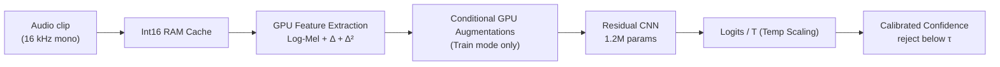

# CommandSense — Spoken Command Recognition

<p align="center">
  <a href="https://github.com/Hades-Highness/spoken-command-recognition/releases/latest">
    
  </a>
  
  
  
  
</p>

<p align="center">
  <a href="#overview">Overview</a> •
  <a href="#results">Results</a> •
  <a href="#model-cards">Model Cards</a> •
  <a href="#pipeline">Pipeline</a> •
  <a href="#quickstart">Quickstart</a> •
  <a href="#training">Training</a> •
  <a href="#deployment-v31">Deployment (v3.1)</a> •
  <a href="#datasets">Datasets</a> •
  <a href="#citation">Citation</a> •
  <a href="#licence">Licence</a>
</p>

---

## Overview

CommandSense is an end-to-end deep learning pipeline for spoken keyword spotting and audio command recognition. It features a 16 kHz high-resolution three-channel Log-Mel spectrogram front-end, a dual-backend deployment architecture, and explicit rejection of silence and out-of-vocabulary (OOV) speech. 

The project documents a deliberate evolution from a naive baseline to a production-ready, memory-optimized, and quantized system. The current release (**v3.1**) is an edge-optimized deployment sibling of **v3.0**, featuring a heavily optimized INT8 artifact for ONNX Runtime Web and edge deployment, while keeping the v3.0 float32 weights frozen.

**What this repository is:** a reproducible pipeline (training, evaluation, ONNX/PyTorch inference, INT8 quantization, web demo), the metrics and calibration artifacts of all previous versions, and a model card per version.

**What it is not:** a general-purpose ASR system. It is a strict 35-command keyword spotter with learned OOV and silence rejection, plus calibrated confidence thresholding.

---

## Results

### Headline (v3.1 Deployment Release)

| Metric | Value | Source of truth |
| :-- | :-- | :-- |
| **Artifact Size (INT8)** | **1.20 MB** (74.1% reduction from v3.0) | `checkpoints/model_v3.1/CommandSense_v3.1_int8.onnx` |
| **Top-1 Agreement** | **99.55%** (vs. float32 v3.0 graph) | `quantize_int8.py` evaluation logs |
| **Test Accuracy (35 cmd)** | 95.8655% (inherited from v3.0) | `reports/model_v3.0/report_v3.0.txt` |
| **Validation Accuracy** | 96.36% | `reports/model_v3.0/history_v3.0.json` |
| **Parameters** | 1,217,349 | `src/models.py` |

### Version progression

Every version is trained with the same residual CNN recipe and evaluated on the same official speaker-disjoint splits. v3.1 is a deployment release and trains no new weights.

| Version | Key Change | Params | Test Acc (35 cmd) | Model Card |
| :-- | :-- | :-: | :-: | :-- |
| **v1.0** | Baseline: single-channel Log-Mel front-end | 1,216,259 | 94.4571% | [v1.0 card](reports/model_v1.0/README.md) |
| **v2.0** | Three-channel front-end: Log-Mel + Δ + Δ² | 1,216,835 | 94.7842% | [v2.0 card](reports/model_v2.0/README.md) |
| **v2.1** | Rejection classes: `_silence_` + `_unknown_` | 1,217,349 | 94.1481% | [v2.1 card](reports/model_v2.1/README.md) |
| **v2.2** | Calibration release: temperature scaling + threshold | 1,217,349 | 94.1481% | [v2.2 card](reports/model_v2.2/README.md) |
| **v3.0** | Memory-optimized pipeline + conditional GPU augmentation | 1,217,349 | **95.8655%** | [v3.0 card](reports/model_v3.0/README.md) |
| **v3.1** | Deployment release: static INT8 (QDQ) quantization of v3.0 | 1,217,349 | 95.8655%* | [v3.1 card](reports/model_v3.1/README.md) |

*\*v3.1 accuracy cells are copies of v3.0 by construction, as no new weights are trained. Read the v3.1 card for quantization fidelity metrics.*

### What the progression shows

- **A single-channel front-end limits the model.** Moving to a 3-channel Log-Mel + Δ + Δ² representation in v2.0 yields a consistent, measurable gain.
- **Rejection capability trades slightly with command accuracy.** Introducing `_silence_` and `_unknown_` in v2.1 costs ~0.64 points on the 35-command task but enables robust real-world deployment.
- **Pipeline efficiency drives the latest accuracy gains.** v3.0 moves the audio cache to `int16` and the feature extraction/augmentation to the GPU. This memory-optimized pipeline allows a longer 30-epoch training schedule, lifting the 35-command Top-1 accuracy to **95.8655%** (+1.72 points) without changing the network architecture.
- **v3.1 is purely a deployment optimization.** It focuses on artifact size and web compatibility via INT8 static quantization, preserving the v3.0 predictive fidelity with 99.55% top-1 agreement.

---

## Model Cards

Each version has a model card documenting its configuration, full classification report, training curves, confusion matrix, and version-specific caveats.

| Version | Card | Focus |
| :-- | :-- | :-- |
| v1.0 | [model_v1.0](reports/model_v1.0/README.md) | Baseline and single-channel limitations |
| v2.0 | [model_v2.0](reports/model_v2.0/README.md) | Dynamic features and temporal resolution |
| v2.1 | [model_v2.1](reports/model_v2.1/README.md) | Learned rejection classes (`_silence_` / `_unknown_`) |
| v2.2 | [model_v2.2](reports/model_v2.2/README.md) | Post-hoc calibration and confidence thresholding |
| v3.0 | [model_v3.0](reports/model_v3.0/README.md) | Memory-optimized pipeline and GPU augmentations |
| v3.1 | [model_v3.1](reports/model_v3.1/README.md) | **Current Release**: INT8 static quantization fidelity |

---

## Pipeline



### Audio and feature specification

| Parameter | Value |
| :-- | :-- |
| Sampling rate | 16,000 Hz, mono |
| Duration | 1.0 s (16,000 samples; zero-padded or truncated) |
| `n_mels` | 64 |
| `n_fft` | 1024 (~64 ms window) |
| `hop_length` | 256 (~16 ms step) |
| Time frames | 63 |
| Channels | 3 — Log-Mel, Δ (first derivative), Δ² (second derivative) |
| Input tensor | `[batch, 3, 64, 63]` |

### Model architecture

| Stage | Configuration | Output shape |
| :-- | :-- | :-- |
| Input | — | `[B, 3, 64, 63]` |
| `in_conv` | `Conv2d(3→32, 3×3)`, BN, ReLU | `[B, 32, 64, 63]` |
| `layer1` | `ResidualBlock(32→64, stride 2)` | `[B, 64, 32, 32]` |
| `layer2` | `ResidualBlock(64→128, stride 2)` | `[B, 128, 16, 16]` |
| `layer3` | `ResidualBlock(128→256, stride 2)` | `[B, 256, 8, 8]` |
| Pooling | `AdaptiveAvgPool2d((1, 1))` | `[B, 256, 1, 1]` |
| Head | Flatten → `Dropout(0.3)` → `Linear(256→37)` | `[B, 37]` |

---

## Repository layout

```text
.
├── checkpoints/                  # Model weight releases (git-ignored; created at runtime)
│   ├── model_v3.0/               # CommandSense_v3.0.pth, CommandSense_v3.0.onnx
│   └── model_v3.1/               # CommandSense_v3.1_int8.onnx
├── configs/                      # Global hyperparameters, paths and class mapping
│   ├── calibration/              # Calibration payload (T and tau)
│   ├── config.py                 
│   └── labels.json               
├── data/                         # Raw datasets (git-ignored, auto-downloaded)
├── reports/                      # Versioned evaluation cards and plots
├── src/                          # Source code modules (dataset, transforms, models, etc.)
├── tests/                        # Pipeline and quantization smoke tests
├── app.py                        # Interactive Gradio Web UI
├── evaluate.py                   # Metrics, calibration fit and tau sweep
├── export_onnx.py                # PyTorch to ONNX exporter
├── quantize_int8.py              # v3.1 static INT8 quantization pipeline
├── requirements.txt              
└── train.py                      # Training pipeline with AMP
```

---

## Quickstart

### 1. Install

```bash
git clone https://github.com/Hades-Highness/spoken-command-recognition.git
cd spoken-command-recognition
pip install -r requirements.txt
```

### 2. Download the model weights

Checkpoints are not committed to keep the repository lightweight. Grab the assets from the [Releases page](https://github.com/Hades-Highness/spoken-command-recognition/releases) and place them in the versioned folders:

```text
checkpoints/model_v3.0/CommandSense_v3.0.pth
checkpoints/model_v3.0/CommandSense_v3.0.onnx
checkpoints/model_v3.1/CommandSense_v3.1_int8.onnx
configs/calibration/CommandSense_calibration_v3.1.json
```

### 3. Run the web app

```bash
python app.py
```

Open the printed local URL, record a command with the microphone, and press **Recognize**. The UI features a live confidence threshold (`tau`) slider to see the reject mechanism in real-time.

### 4. Check the architecture loads

```bash
python -m pytest tests/
```
This runs lightweight pipeline and quantization smoke tests to ensure the PyTorch and ONNX backends are correctly resolving the checkpoints and calibration payloads.

---

## Training

### 1. Get the data

`train.py` automatically downloads **Google Speech Commands v0.02** (≈2.3 GB) and **LibriSpeech** (≈6.3 GB) on the first run via a resilient downloader with SSL fallbacks.

### 2. Train

```bash
python train.py
```

The first training run caches the raw audio as `int16` in RAM and builds the 3-channel spectrograms on the GPU. An epoch takes ≈25–30 s on a single T4 at batch size 256.

| Setting | Value |
| :-- | :-- |
| Epochs | 30 |
| Optimizer | AdamW, lr `1e-3`, weight decay `1e-4` |
| Loss | `CrossEntropyLoss` |
| Batch size | 256 |

### 3. Augmentations (training only, applied on GPU)

| Augmentation | Behaviour |
| :-- | :-- |
| Spectral Shift | STFT-domain pitch shift (`torch.roll`), replaces the heavy phase vocoder. |
| Time Shift | Single `torch.roll` on the waveform. |
| SpecAugment | Independent per-clip frequency and time masks. |

**Note:** Augmentations are strictly disabled for the `_silence_` class to preserve the exact OOD noise boundary.

---

## Evaluation

```bash
python evaluate.py    # fits T/tau and generates reports
```

`evaluate.py` computes the classification report, fits the temperature scaling parameter `T`, and sweeps the confidence threshold `tau` on the validation split. It writes all plots and text reports into `reports/model_v3.0/`.

---

## Web App

`app.py` starts a Gradio interface that supports live microphone input. 

- Browser recordings arrive as WebM/Opus; the pipeline decodes them transparently.
- It uses the dual-backend inferencer (`src/inference.py`), preferring ONNX Runtime if available, falling back to PyTorch.
- It applies the calibrated temperature `T` and confidence threshold `tau`. Predictions falling below `tau` are explicitly rejected as `_unknown_`.

---

## Deployment (v3.1)

**CommandSense v3.1** is an edge and web deployment release. It serves as the **INT8 sibling of the v3.0 ONNX graph** via post-training static quantization.

```bash
python export_onnx.py    # exports v3.0 to float32 ONNX
python quantize_int8.py  # generates the v3.1 INT8 artifact
```

- **Static INT8 Quantization:** Exports the v3.0 graph to QDQ format (per-channel int8 weights, int8 activations), calibrated on 500 validation clips.
- **74.1% Size Reduction:** Artifact size drops from **4.64 MB** to **1.20 MB**, making it highly suitable for ONNX Runtime Web and edge devices.
- **High Fidelity:** Maintains **99.55% top-1 agreement** with the float32 graph on the testing split. Discrepancies are strictly confined to low-margin ties.
- **Deployment Focus:** CPU latency is not improved (1.68x slower on CPU provider); the value proposition is purely artifact size and web compatibility.

---

## Rejection & Confidence Thresholding

The model explicitly learns to reject via two non-command classes: `_silence_` (background noise) and `_unknown_` (LibriSpeech OOV speech). 

Additionally, v2.2 introduced a **calibrated confidence threshold** (`tau`), which was re-fitted for v3.0 (`T = 1.3116`, `tau* = 0.89`). 

A clip is answered only when its calibrated top-1 probability reaches `tau`; otherwise, it is served as `_unknown_`. This buys precision (**99.48% retained accuracy** on answered clips) at the cost of coverage (**89.76%** of clips answered).

---

## Datasets

| Dataset | Content | Source rate | Licence |
| :-- | :-- | :-: | :-- |
| **Google Speech Commands v0.02** | 105,829 clips, 35 command words + background noise | 16 kHz | CC BY 4.0 |
| **LibriSpeech** | `train-clean-100` and `dev-clean` used to build the disjoint `_unknown_` class | 16 kHz | CC BY 4.0 |

Both datasets are loaded via `torchaudio` using speaker-disjoint splits, ensuring that evaluation metrics are not inflated by speaker identity.

---

## Reproducibility and limitations

**Reproducible today:** v3.0 training, evaluation, calibration, and v3.1 INT8 quantization from Speech Commands and LibriSpeech. Inference via PyTorch, ONNX, and INT8 backends.

**Known gaps and limitations:**
- **CPU latency on INT8:** v3.1 reduces artifact size for web compatibility, but the INT8 CPU provider is currently ~1.68x slower than the float32 CPU provider.
- **Single-run metrics:** The reported v3.0 accuracy is the result of a single training run. 
- **1.0s rigid window:** Clips are force-fitted to 1.0s. Utterances longer than one second are truncated, and silence-trimmed clips are zero-padded when shorter.
- **Scope:** Strict 35-command keyword spotting with OOV rejection, not continuous speech recognition.

---

## Roadmap

- [ ] Benchmark WebAssembly (WASM) inference latency using the v3.1 INT8 graph.
- [ ] Implement an ONNX graph optimization pass to fuse QDQ nodes and recover CPU latency for v3.1.
- [ ] Expand the vocabulary beyond the Google Speech Commands 35-word subset.

---

## Citation

**Google Speech Commands** (used for command training and evaluation):

```bibtex
@article{warden2018speech,
  title   = {Speech Commands: A Dataset for Limited-Vocabulary Speech Recognition},
  author  = {Warden, Pete},
  journal = {arXiv preprint arXiv:1804.03209},
  year    = {2018},
  url     = {https://arxiv.org/abs/1804.03209}
}
```

**LibriSpeech** (used for the `_unknown_` OOV speech class):

```bibtex
@inproceedings{panayotov2015librispeech,
  title     = {LibriSpeech: An ASR corpus based on public domain audio books},
  author    = {Panayotov, Vassil and Chen, Guoguo and Povey, Daniel and Khudanpur, Sanjeev},
  booktitle = {2015 IEEE International Conference on Acoustics, Speech and Signal Processing (ICASSP)},
  pages     = {5206--5210},
  year      = {2015},
  doi       = {10.1109/ICASSP.2015.7178964}
}
```

---

## Licence

This project is released under the **MIT Licence** — © 2026 Hades-Highness.

The datasets keep their own terms (both CC BY 4.0). Model checkpoints published as release assets are covered by this project's MIT licence, but any model retrained or redistributed using the datasets must also respect their licences.

---

## Acknowledgements

- **Google Speech Commands** and **LibriSpeech** for the datasets.
- **Gradio**, **PyTorch**, **torchaudio**, and **ONNX Runtime** for the framework stack.