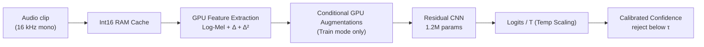

# CommandSense — Spoken Command Recognition

<p align="center">
  <a href="https://github.com/Hades-Highness/spoken-command-recognition/releases/latest">
    
  </a>
  
  
  
  
</p>

<p align="center">
  <a href="#overview">Overview</a> •
  <a href="#results">Results</a> •
  <a href="#model-cards">Model Cards</a> •
  <a href="#pipeline">Pipeline</a> •
  <a href="#repository-layout">Repository Layout</a> •
  <a href="#quickstart">Quickstart</a> •
  <a href="#training">Training</a> •
  <a href="#evaluation">Evaluation</a> •
  <a href="#datasets">Datasets</a> •
  <a href="#reproducibility-and-limitations">Reproducibility</a> •
  <a href="#citation">Citation</a> •
  <a href="#licence">Licence</a>
</p>

---

## Overview

CommandSense is an end-to-end deep learning pipeline for spoken keyword spotting and audio command recognition. It features a 16 kHz high-resolution three-channel Log-Mel spectrogram front-end, a dual-backend deployment architecture, and explicit rejection of silence and out-of-vocabulary (OOV) speech.

The repository documents each released version with its own model card, metrics and artifacts. The current release (**v3.2**) is an application and integration milestone: it serves the unchanged v3.1 INT8 graph and v3.0 float32 weights through a unified, two-tab Gradio interface built on a thread-safe real-time `KeywordSpotter`. No weights were trained and no calibration values were re-fitted for this release.

**What this repository is:** a reproducible pipeline (training, evaluation, ONNX/PyTorch inference, INT8 quantization, web demo), the metrics and calibration artifacts of all previous versions, and a model card per version.

**What it is not:** a general-purpose ASR system. It is a strict 35-command keyword spotter with learned OOV and silence rejection, plus calibrated confidence thresholding.

---

## Results

### Headline (v3.2 Application Release)

| Metric | Value | Source of truth |
| :-- | :-- | :-- |
| **Artifact Size (INT8)** | **1.20 MB** (74.1% reduction from float32) | `checkpoints/model_v3.2/CommandSense_v3.2_int8.onnx` |
| **Top-1 Agreement** | **99.55%** (vs. float32 graph; inherited from v3.1) | `reports/model_v3.1/quantization_report.txt` |
| **Real-time latency (CPU)** | **21.1 ms** median per 1.0 s window (p95 38.8 ms) | `reports/model_v3.2/README.md` |
| **Inference budget** | **4.3%** of the 0.5 s hop | `reports/model_v3.2/README.md` |
| **Warm-up** | **83 ms** median (30-143 ms over 5 runs) | `reports/model_v3.2/README.md` |
| **Concurrent inference** | 200 calls from 8 threads, 0 label or confidence mismatches | `reports/model_v3.2/README.md` |
| **Test Accuracy (35 cmd)** | 95.8655% (inherited from v3.0) | `reports/model_v3.0/report_v3.0.txt` |
| **Validation Accuracy** | 96.36% | `reports/model_v3.0/history_v3.0.json` |
| **Parameters** | 1,217,349 | `src/models.py` |

### Version progression

Every version is trained with the same residual CNN recipe and evaluated on the same official speaker-disjoint splits, so the columns below are directly comparable. v3.1 and v3.2 are deployment and application releases respectively; neither trains new weights.

| Version | Key change | Params | Val Acc | Test Acc (35 cmd) | Test Macro F1 | Rejection recall | Overall | Δ Test | Model Card |
| :-- | :-- | :-: | :-: | :-: | :-: | :-: | :-: | :-: | :-- |
| **v1.0** | Baseline: single-channel Log-Mel front-end | 1,216,259 | 94.66% | 94.4571% | 0.9406 | — | 94.4571% | — | [v1.0 card](reports/model_v1.0/README.md) |
| **v2.0** | Three-channel front-end: Log-Mel + Δ + Δ² | 1,216,835 | 94.77% | 94.7842% | 0.9436 | — | 94.7842% | +0.3271 | [v2.0 card](reports/model_v2.0/README.md) |
| **v2.1** | Rejection classes: `_silence_` + `_unknown_` | 1,217,349 | 94.96% † | **94.1481%** | **0.9363** | `_silence_` 97.82%<br>`_unknown_` 98.36% | 94.5064% | **−0.6361** | [v2.1 card](reports/model_v2.1/README.md) |
| **v2.2** | Calibration release: temperature scaling + threshold | 1,217,349 | 94.94% | **94.1481%** | 0.9364 | `_silence_` 98.36%<br>`_unknown_` 99.09% | 94.5642% | **0.0000** ‡ | [v2.2 card](reports/model_v2.2/README.md) |
| **v3.0** | Memory-optimized pipeline + conditional GPU augmentation | 1,217,349 | 96.36% | **95.8655%** | 0.9541 § | `_silence_` 100.00%<br>`_unknown_` 98.55% | 96.1751% | **+1.7174** | [v3.0 card](reports/model_v3.0/README.md) |
| **v3.1** | Deployment release: static INT8 (QDQ) quantization | 1,217,349 | 96.36% | 95.8655%* | 0.9541 § | `_silence_` 100.00%<br>`_unknown_` 98.55% | 96.1751% | 0.0000 | [v3.1 card](reports/model_v3.1/README.md) |
| **v3.2** | Application release: unified Gradio UI and real-time spotter | 1,217,349 | 96.36% | 95.8655%* | 0.9541 § | `_silence_` 100.00%<br>`_unknown_` 98.55% | 96.1751% | 0.0000 | [v3.2 card](reports/model_v3.2/README.md) |

† The v2.1 validation split contains 10,979 clips (9,981 commands + 998 rejection samples), so its `Val Acc` is not comparable to the rows above. The comparable figures are the test columns.

‡ v2.2 takes **no gradient step at all**: `Δ Test` is zero by construction, not by measurement, because temperature scaling cannot change an argmax. All 11,005 command clips are classified exactly as in the v2.1 pass — the per-class recall of every one of the 35 commands is identical row-for-row in the two reports — so every accuracy cell on the command task is a copy of the v2.1 cell. Only the columns that mix in the redrawn rejection clips move — `Test Macro F1` (0.9363 → 0.9364, through precision), `Overall` (94.5064 % → 94.5642 %) and `Rejection recall` — and they move only because `src/dataset.py` slices the 1,100 synthetic `_silence_` / `_unknown_` clips out of the held-out recordings at load time instead of storing them on disk. Treat the v2.2 row as a _calibration and rejection_ result, not an accuracy result.

§ v3.0's `Test Macro F1` is the unweighted mean of the 35 command-class F1 scores printed in `reports/model_v3.0/report_v3.0.txt`; the same report gives the 37-class macro average as `0.9560`. Unlike v2.2, v3.0 trains new weights, so its row is a genuine accuracy result.

\*v3.1 accuracy cells are copies of v3.0 by construction, as no new weights are trained. Read the v3.1 card for quantization fidelity metrics.

### What the progression shows

- **A single-channel front-end limits the model.** Moving to a 3-channel Log-Mel + Δ + Δ² representation in v2.0 establishes the multi-channel front-end used in all subsequent versions.
- **Rejection capability trades slightly with command accuracy.** Introducing `_silence_` and `_unknown_` in v2.1 costs ~0.64 points on the 35-command task but enables robust real-world deployment.
- **Pipeline efficiency drives the latest accuracy gains.** v3.0 moves the audio cache to `int16` and the feature extraction/augmentation to the GPU. This memory-optimized pipeline allows a longer 30-epoch training schedule, lifting the 35-command Top-1 accuracy to **95.8655%** (+1.72 points) without changing the network architecture.
- **v3.1 is purely a deployment optimization.** It focuses on artifact size and web compatibility via INT8 static quantization, preserving the v3.0 predictive fidelity with 99.55% top-1 agreement.
- **v3.2 is purely an application release.** It adds the unified Gradio interface, the per-session `KeywordSpotter` and the shared ONNX session without changing the model, the calibration or the predictive metrics. Its new numbers describe latency, concurrency and lifecycle behaviour, not accuracy.

---

## Model Cards

Each version has a model card documenting its configuration, full classification report, training curves, confusion matrix, and version-specific caveats.

| Version | Card | Focus |
| :-- | :-- | :-- |
| v1.0 | [model_v1.0](reports/model_v1.0/README.md) | Baseline and single-channel limitations |
| v2.0 | [model_v2.0](reports/model_v2.0/README.md) | Dynamic features and temporal resolution |
| v2.1 | [model_v2.1](reports/model_v2.1/README.md) | Learned rejection classes (`_silence_` / `_unknown_`) |
| v2.2 | [model_v2.2](reports/model_v2.2/README.md) | Post-hoc calibration and confidence thresholding |
| v3.0 | [model_v3.0](reports/model_v3.0/README.md) | Memory-optimized pipeline and GPU augmentations |
| v3.1 | [model_v3.1](reports/model_v3.1/README.md) | INT8 static quantization fidelity |
| v3.2 | [model_v3.2](reports/model_v3.2/README.md) | **Current Release**: real-time application layer, latency and thread safety |

---

## Pipeline



### Audio and feature specification

| Parameter | Value |
| :-- | :-- |
| Sampling rate | 16,000 Hz, mono |
| Duration | 1.0 s (16,000 samples; zero-padded or truncated) |
| `n_mels` | 64 |
| `n_fft` | 1024 (~64 ms window) |
| `hop_length` | 256 (~16 ms step) |
| Time frames | 63 |
| Channels | 3 — Log-Mel, Δ (first derivative), Δ² (second derivative) |
| Input tensor | `[batch, 3, 64, 63]` |

### Model architecture

| Stage | Configuration | Output shape |
| :-- | :-- | :-- |
| Input | — | `[B, 3, 64, 63]` |
| `in_conv` | `Conv2d(3→32, 3×3)`, BN, ReLU | `[B, 32, 64, 63]` |
| `layer1` | `ResidualBlock(32→64, stride 2)` | `[B, 64, 32, 32]` |
| `layer2` | `ResidualBlock(64→128, stride 2)` | `[B, 128, 16, 16]` |
| `layer3` | `ResidualBlock(128→256, stride 2)` | `[B, 256, 8, 8]` |
| Pooling | `AdaptiveAvgPool2d((1, 1))` | `[B, 256, 1, 1]` |
| Head | Flatten → `Dropout(0.3)` → `Linear(256→37)` | `[B, 37]` |

---

## Repository layout

```text
.
├── checkpoints/                  # Model weight releases (git-ignored; created at runtime)
│   ├── model_v3.0/               # FP32 weights and float32 ONNX reference
│   ├── model_v3.1/               # INT8 deployment artifacts
│   └── model_v3.2/               # v3.2 bundle: same weights and INT8 graph
├── configs/                      # Global hyperparameters, paths and class mapping
│   ├── calibration/              # Calibration payload (T and tau)
│   ├── config.py                 
│   └── labels.json               
├── data/                         # Raw datasets (git-ignored, auto-downloaded)
├── reports/                      # Versioned model cards and evaluation artifacts
│   ├── model_v3.0/               # Training, evaluation and calibration reports
│   ├── model_v3.1/               # INT8 quantization report
│   └── model_v3.2/               # Application-layer model card
├── src/                          # Source modules (dataset, transforms, models, inference)
├── tests/                        # Pipeline, calibration and quantization smoke tests
├── app.py                        # Unified two-tab Gradio interface
├── evaluate.py                   # Metrics, calibration fit and tau sweep
├── export_onnx.py                # PyTorch to ONNX exporter
├── listen.py                     # SharedRuntime, KeywordSpotter and optional CLI
├── quantize_int8.py              # Static INT8 quantization pipeline
├── requirements.txt              
└── train.py                      # Training pipeline with AMP
```

---

## Quickstart

### 1. Install

```bash
git clone https://github.com/Hades-Highness/spoken-command-recognition.git
cd spoken-command-recognition
pip install -r requirements.txt
```

### 2. Download the model weights

Checkpoints are not committed to keep the repository lightweight. Grab the **v3.2 release bundle** from the [Releases page](https://github.com/Hades-Highness/spoken-command-recognition/releases) and place the files into the versioned folder:

```text
checkpoints/model_v3.2/
├── CommandSense_v3.2.pth         # Same weights as v3.1 and v3.0; included for a self-contained release
└── CommandSense_v3.2_int8.onnx   # Same INT8 QDQ graph as v3.1
```

The fitted operating point is tracked in git at `configs/calibration/CommandSense_calibration_v3.2.json` (`T = 1.311633`, `tau = 0.89`) and is resolved automatically. The runtime also probes the versioned checkpoint folder for a copy of the payload.

*(Note: To reproduce training from scratch, use `train.py`, which writes to `checkpoints/model_v3.0/`. To rebuild the INT8 graph, use `python quantize_int8.py`. Neither step is required for the v3.2 application release.)*

### 3. Launch the unified web interface

```bash
python app.py
```

Open the printed local URL. Both tabs share one process-wide `SharedRuntime`, so the labels, calibration payload, mel front-end and ONNX session are loaded once.

- **Real-time Keyword Spotting** - continuous microphone listening through `KeywordSpotter`. Select an input device, press **Start Listening**, and accepted commands appear in the detection history with their calibrated confidence. The tab shows the current loop state, the latest classified window, the active `T`/`tau`, and any cooldown or audio-stream warning. A new 1.0 s window is classified every 0.5 s, and a 1.5 s cooldown prevents overlapping windows from repeating the same command.
- **Single Recording Analysis** - record with the browser or upload a clip, choose the ONNX or PyTorch backend, and press **Classify Command**. The tab reports the verdict, the top-6 calibrated probabilities, and the decision details. The `tau` slider is applied to that request only, so threshold tuning never changes the fitted operating point used by the live tab.

The real-time tab requires the ONNX graph and a fitted calibration payload. Single-recording analysis can still run on the `.pth` weights when the ONNX graph is absent. Closing or refreshing the browser releases that session's microphone; inference calls from both tabs are serialized by `SharedRuntime.inference_lock`.

If startup fails, the interface still launches with a warning in the header and disables the controls that cannot run. The underlying exception is shown in the page so the missing artifact or backend can be fixed without reading the server console.

### 4. Use listen.py as a standalone CLI (optional)

`listen.py` is a module first: it provides `SharedRuntime`, `get_shared_runtime` and `KeywordSpotter` to the web interface. The optional command-line entry point is retained for scripted microphone checks:

```bash
python listen.py --list-devices     # list capturable input devices
python listen.py --device 1         # capture, classify every 0.5 s, Ctrl+C to stop
```

The CLI captures 16 kHz mono audio, rebuilds features with the shared `AudioToThreeChannelMel` front-end, and runs the ONNX graph of the `MODEL_VERSION` selected in `configs/config.py`. It prints a detection only when the calibrated top-1 probability reaches `tau`, the label is not a rejection class, and the cooldown has elapsed.

### 5. Validate the pipeline

```bash
python tests/test_v3_pipeline.py
python tests/test_calibration_smoke.py
```

These scripts run directly and verify that the PyTorch and ONNX backends resolve the versioned checkpoints, that the feature pipeline produces `[batch, 3, 64, 63]` tensors, and that the calibration math is intact. If `pytest` is installed, the same tests can be discovered with `python -m pytest tests/ -q`.

`python tests/test_v3_1_quantization.py` re-measures the INT8 artifact and is only expected to pass after the v3.1 quantization artifacts have been built.

---

## Training

### 1. Get the data

`train.py` automatically downloads **Google Speech Commands v0.02** (≈2.3 GB) and **LibriSpeech** (≈6.3 GB) on the first run via a resilient downloader with SSL fallbacks.

### 2. Train

```bash
python train.py
```

The first training run caches the raw audio as `int16` in RAM and builds the 3-channel spectrograms on the GPU. An epoch takes ≈25–30 s on a single T4 at batch size 256.

| Setting | Value |
| :-- | :-- |
| Epochs | 30 |
| Optimizer | AdamW, lr `1e-3`, weight decay `1e-4` |
| Loss | `CrossEntropyLoss` |
| Batch size | 256 |

### 3. Augmentations (training only, applied on GPU)

| Augmentation | Behaviour |
| :-- | :-- |
| Spectral Shift | STFT-domain pitch shift (`torch.roll`), replaces the heavy phase vocoder. |
| Time Shift | Single `torch.roll` on the waveform. |
| SpecAugment | Independent per-clip frequency and time masks. |

**Note:** Augmentations are strictly disabled for the `_silence_` class to preserve the exact OOD noise boundary.

---

## Evaluation

```bash
python evaluate.py    # fits T/tau and generates reports
```

`evaluate.py` computes the classification report, fits the temperature scaling parameter `T`, and sweeps the confidence threshold `tau` on the validation split. It writes all plots and text reports into `reports/model_v3.0/`.

---

## Unified Web Interface

`app.py` starts a two-tab Gradio application that shares one process-wide `SharedRuntime`: the model, label map, calibration payload, mel front-end and ONNX session are loaded once and reused by both tabs and by every browser session.

### Real-time Keyword Spotting

The live tab is a continuous microphone interface built on `KeywordSpotter`:

- One spotter is created per browser session and registered in `_SESSIONS`; it classifies against the shared ONNX session rather than opening a second graph.
- `sounddevice` captures 16 kHz mono audio into a four-second ring buffer. The loop classifies a 1.0 s window every 0.5 s and applies a 1.5 s cooldown after an accepted command.
- A `gr.Timer` polls the detection queue every 0.15 s, and only while that session is listening, so an idle tab performs no polling work.
- The status indicator distinguishes idle, listening and error states. The detail panel reports the latest window, its calibrated confidence, the rejection reason when applicable, and the active `T`/`tau`.
- The detection history is capped at 100 messages. Clicking **Clear History** does not interrupt the microphone loop.
- Closing or refreshing the tab calls `Blocks.unload`, which stops the loop and releases the microphone. Process exit also stops every registered spotter.

### Single Recording Analysis

The one-shot tab accepts browser recordings or uploads and sends them through `CommandInferencer.predict` on the same shared runtime:

- WebM/Opus recordings are decoded transparently by the shared audio loader.
- The backend selector offers ONNX Runtime and PyTorch when both are available; `auto` prefers ONNX.
- The `tau` slider is applied to the returned probabilities inside the callback. It never calls `set_calibration`, so tuning it cannot change the fitted operating point used by the real-time tab or by another session.
- The result view reports the verdict, the top-6 calibrated probabilities, the served and top-1 labels, the threshold decision, the temperature and the backend.

### Shared lifecycle and concurrency

- Both tabs apply the fitted temperature `T`; predictions below `tau` are served as `_unknown_`.
- Inference calls are serialized by `SharedRuntime.inference_lock`, because one ONNX Runtime session is shared by every spotter and by the clip tab.
- Startup failures are captured in `INIT_ERROR`. The interface still launches, the header shows the cause, and the affected controls are disabled.
- The real-time tab additionally requires the ONNX graph and a fitted calibration payload; the clip tab can still use the `.pth` weights without them.

Measured on the reference CPU host, the real-time path takes **21.1 ms** per 1.0 s window at the median, which is **4.3%** of the 0.5 s hop. See [the v3.2 model card](reports/model_v3.2/README.md) for the full latency and concurrency methodology.

---

## Deployment Lineage (v3.1 to v3.2)

**CommandSense v3.1** is the edge and web deployment release. It serves the **INT8 sibling of the v3.0 ONNX graph** via post-training static quantization.

```bash
python export_onnx.py    # exports v3.0 to float32 ONNX
python quantize_int8.py  # generates the v3.1 INT8 artifact
```

- **Static INT8 Quantization:** Exports the v3.0 graph to QDQ format (per-channel int8 weights, int8 activations), calibrated on 500 validation clips.
- **74.1% Size Reduction:** Artifact size drops from **4.64 MB** to **1.20 MB**, making it suitable for ONNX Runtime Web and edge devices.
- **High Fidelity:** Maintains **99.55% top-1 agreement** with the float32 graph on the testing split. Discrepancies are confined to low-margin decisions.
- **Deployment Focus:** CPU latency is not improved (1.68x slower on the CPU provider); the value proposition is artifact size and web compatibility.

**CommandSense v3.2** is the application release built on those artifacts. It introduces no new graph and no new calibration: the INT8 artifact, FP32 weights and `T`/`tau` values are identical to the v3.1 and v3.0 lineage. The release adds the unified Gradio interface, the per-session real-time spotter and the lifecycle guarantees described above. Its measured contribution is an inference path that uses less than 5% of the real-time hop budget on the reference CPU.

---

## Rejection & Confidence Thresholding

The model explicitly learns to reject via two non-command classes: `_silence_` (background noise) and `_unknown_` (LibriSpeech OOV speech).

Additionally, v2.2 introduced a **calibrated confidence threshold** (`tau`), which was re-fitted for v3.0 (`T = 1.3116`, `tau* = 0.89`). v3.1 transferred that operating point to the INT8 graph and v3.2 serves it unchanged.

A clip is answered only when its calibrated top-1 probability reaches `tau`; otherwise, it is served as `_unknown_`. On the INT8 graph that v3.2 serves, this buys precision (**99.50% retained accuracy** on answered clips) at the cost of coverage (**89.98%** of clips answered; the float32 graph answers 89.76%).

---

## Datasets

| Dataset | Content | Source rate | Licence |
| :-- | :-- | :-: | :-- |
| **Google Speech Commands v0.02** | 105,829 clips, 35 command words + background noise | 16 kHz | CC BY 4.0 |
| **LibriSpeech** | `train-clean-100` and `dev-clean` used to build the disjoint `_unknown_` class | 16 kHz | CC BY 4.0 |

Both datasets are loaded via `torchaudio` using speaker-disjoint splits, ensuring that evaluation metrics are not inflated by speaker identity.

---

## Reproducibility and limitations

**Reproducible today:** v3.0 training, evaluation and calibration; v3.1 INT8 quantization; and the v3.2 application layer from Speech Commands and LibriSpeech. Inference is available through the PyTorch, ONNX and INT8 backends.

**Known gaps and limitations:**
- **Overlapping speech:** The model assumes one dominant command in each 1.0 s window. Overlapping talkers (the cocktail party problem) are not separated; the window is classified as a mixture. v4.0 will address this with data mixing.
- **CPU latency on INT8:** v3.1 reduces artifact size for web compatibility, but the INT8 CPU provider is currently ~1.68x slower than the float32 CPU provider.
- **Single-host latency measurements:** The v3.2 timings describe one six-core CPU host. They are not a guarantee for mobile, WebAssembly or GPU deployments.
- **Single-run metrics:** The reported v3.0 accuracy is the result of a single training run.
- **1.0 s rigid window:** Clips are force-fitted to 1.0 s. Utterances longer than one second are truncated, and silence-trimmed clips are zero-padded when shorter.
- **Scope:** Strict 35-command keyword spotting with OOV rejection, not continuous speech recognition.

---

## Roadmap

- [ ] Address overlapping speech in v4.0 with mixed-speech training data.
- [ ] Benchmark WebAssembly (WASM) inference latency using the v3.1 INT8 graph.
- [ ] Implement an ONNX graph optimization pass to fuse QDQ nodes and recover CPU latency for v3.1.
- [ ] Expand the vocabulary beyond the Google Speech Commands 35-word subset.

---

## Citation

**Google Speech Commands** (used for command training and evaluation):

```bibtex
@article{warden2018speech,
  title   = {Speech Commands: A Dataset for Limited-Vocabulary Speech Recognition},
  author  = {Warden, Pete},
  journal = {arXiv preprint arXiv:1804.03209},
  year    = {2018},
  url     = {https://arxiv.org/abs/1804.03209}
}
```

**LibriSpeech** (used for the `_unknown_` OOV speech class):

```bibtex
@inproceedings{panayotov2015librispeech,
  title     = {LibriSpeech: An ASR corpus based on public domain audio books},
  author    = {Panayotov, Vassil and Chen, Guoguo and Povey, Daniel and Khudanpur, Sanjeev},
  booktitle = {2015 IEEE International Conference on Acoustics, Speech and Signal Processing (ICASSP)},
  pages     = {5206--5210},
  year      = {2015},
  doi       = {10.1109/ICASSP.2015.7178964}
}
```

---

## Licence

This project is released under the **MIT Licence** — © 2026 Hades-Highness.

The datasets keep their own terms (both CC BY 4.0). Model checkpoints published as release assets are covered by this project's MIT licence, but any model retrained or redistributed using the datasets must also respect their licences.

---

## Acknowledgements

- **Google Speech Commands** and **LibriSpeech** for the datasets.
- **Gradio**, **PyTorch**, **torchaudio**, and **ONNX Runtime** for the framework stack.