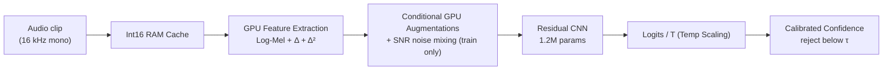

# CommandSense — Spoken Command Recognition

<p align="center">
  <a href="https://github.com/Hades-Highness/spoken-command-recognition/releases/latest">
    
  </a>
  
  
  
  
</p>

<p align="center">
  <a href="#overview">Overview</a> •
  <a href="#results">Results</a> •
  <a href="#model-cards">Model Cards</a> •
  <a href="#pipeline">Pipeline</a> •
  <a href="#repository-layout">Repository Layout</a> •
  <a href="#quickstart">Quickstart</a> •
  <a href="#training">Training</a> •
  <a href="#evaluation">Evaluation</a> •
  <a href="#unified-web-interface">Web Interface</a> •
  <a href="#datasets">Datasets</a> •
  <a href="#reproducibility-and-limitations">Reproducibility</a> •
  <a href="#citation">Citation</a> •
  <a href="#licence">Licence</a>
</p>

---

## Overview

CommandSense is an end-to-end deep learning pipeline for spoken keyword spotting and audio command recognition. It features a 16 kHz high-resolution three-channel Log-Mel spectrogram front-end, a dual-backend deployment architecture, and explicit rejection of silence and out-of-vocabulary (OOV) speech.

The repository documents each released version with its own model card, metrics and artifacts. The current release (**v4.0**) adds **SNR-controlled noise mixing** during training to improve robustness to background speech and ambient noise. Unlike v3.1 and v3.2, v4.0 trains new weights — the architecture is unchanged, but eligible command clips now include mixed-noise conditions. A held-out noise evaluation reports substantially higher command accuracy than v3.0 at every tested SNR from 5 to 20 dB.

**What this repository is:** a reproducible pipeline (training, evaluation, ONNX/PyTorch inference, INT8 quantization, web demo), the metrics and calibration artifacts of all previous versions, and a model card per version.

**What it is not:** a general-purpose ASR system. It is a strict 35-command keyword spotter with learned OOV and silence rejection, plus calibrated confidence thresholding.

---

## Results

### Headline (v4.0 Noise-Mixing Release)

| Metric | Value | Source of truth |
| :-- | :-- | :-- |
| **Test Accuracy (35 cmd)** | **95.6111%** (10,522 / 11,005) | `reports/model_v4.0/report_v4.0.txt` |
| **Validation Accuracy** | **96.41%** | `reports/model_v4.0/report_v4.0.txt` |
| **Noise mixing** | 50% of eligible training clips mixed at controlled SNR | `configs/config.py` |
| **Artifact Size (FP32)** | 4.67 MB | `checkpoints/model_v4.0/CommandSense_v4.0.pth` |
| **Parameters** | 1,217,349 | `src/models.py` |

On the clean 35-command test split, v4.0 scores 0.25 points below v3.0. On the held-out noise evaluation, v4.0 improves mean Top-1 accuracy by **19.36 points** over v3.0 across four tested SNRs (5–20 dB). See the [v4.0 model card](reports/model_v4.0/README.md) and [`robustness_report_v4.0.txt`](reports/model_v4.0/robustness_report_v4.0.txt) for per-condition results and protocol details.

| SNR | v4.0 Top-1 | v3.0 Top-1 | Difference |
| :-: | --: | --: | --: |
| 5 dB | 75.24% | 50.96% | **+24.28 pp** |
| 10 dB | 88.45% | 63.54% | **+24.91 pp** |
| 15 dB | 92.69% | 74.27% | **+18.43 pp** |
| 20 dB | 93.94% | 84.10% | **+9.84 pp** |
| Mean, 5–20 dB | **87.58%** | **68.22%** | **+19.36 pp** |

The test reuses the same 11,005 clean command clips for both models and mixes each condition with the same held-out ambient/speech noise. Top-1 is raw argmax; the thresholded rejection and accepted-accuracy results are reported separately in the model card. This is evidence for improved performance under these tested mixtures, not a claim about all noisy environments.

### Version progression

The command metrics use the official speaker-disjoint splits, but not every row represents a newly trained model or an identical evaluation population. v2.1 has a different validation composition; v2.2, v3.1 and v3.2 do not train new weights, as detailed in the notes below.

| Version | Key change | Params | Val Acc | Test Acc (35 cmd) | Test Macro F1 | Rejection recall | Overall | Δ Test | Model Card |
| :-- | :-- | :-: | :-: | :-: | :-: | :-: | :-: | :-: | :-- |
| **v1.0** | Baseline: single-channel Log-Mel front-end | 1,216,259 | 94.66% | 94.4571% | 0.9406 | — | 94.4571% | — | [v1.0 card](reports/model_v1.0/README.md) |
| **v2.0** | Three-channel front-end: Log-Mel + Δ + Δ² | 1,216,835 | 94.77% | 94.7842% | 0.9436 | — | 94.7842% | +0.3271 | [v2.0 card](reports/model_v2.0/README.md) |
| **v2.1** | Rejection classes: `_silence_` + `_unknown_` | 1,217,349 | 94.96% † | **94.1481%** | **0.9363** | `_silence_` 97.82%<br>`_unknown_` 98.36% | 94.5064% | **−0.6361** | [v2.1 card](reports/model_v2.1/README.md) |
| **v2.2** | Calibration release: temperature scaling + threshold | 1,217,349 | 94.94% | **94.1481%** | 0.9364 | `_silence_` 98.36%<br>`_unknown_` 99.09% | 94.5642% | **0.0000** ‡ | [v2.2 card](reports/model_v2.2/README.md) |
| **v3.0** | Memory-optimized pipeline + conditional GPU augmentation | 1,217,349 | 96.36% | **95.8655%** | 0.9541 § | `_silence_` 100.00%<br>`_unknown_` 98.55% | 96.1751% | **+1.7174** | [v3.0 card](reports/model_v3.0/README.md) |
| **v3.1** | Deployment release: static INT8 (QDQ) quantization | 1,217,349 | 96.36% | 95.8655%\* | 0.9541 § | `_silence_` 100.00%<br>`_unknown_` 98.55% | 96.1751% | 0.0000 | [v3.1 card](reports/model_v3.1/README.md) |
| **v3.2** | Application release: unified Gradio UI and real-time spotter | 1,217,349 | 96.36% | 95.8655%\* | 0.9541 § | `_silence_` 100.00%<br>`_unknown_` 98.55% | 96.1751% | 0.0000 | [v3.2 card](reports/model_v3.2/README.md) |
| **v4.0** | Noise-mixing training release | 1,217,349 | 96.41% | 95.6111% | 0.9533 | `_silence_` 100.00%<br>`_unknown_` 97.64% | 95.9025% | **−0.2544** | [v4.0 card](reports/model_v4.0/README.md) |

† The v2.1 validation split contains 10,979 clips (9,981 commands + 998 rejection samples), so its `Val Acc` is not comparable to the rows above. The comparable figures are the test columns.

‡ v2.2 takes **no gradient step at all**: `Δ Test` is zero by construction, not by measurement, because temperature scaling cannot change an argmax. All 11,005 command clips are classified exactly as in the v2.1 pass — the per-class recall of every one of the 35 commands is identical row-for-row in the two reports — so every accuracy cell on the command task is a copy of the v2.1 cell. Only the columns that mix in the redrawn rejection clips move — `Test Macro F1` (0.9363 → 0.9364, through precision), `Overall` (94.5064 % → 94.5642 %) and `Rejection recall` — and they move only because `src/dataset.py` slices the 1,100 synthetic `_silence_` / `_unknown_` clips out of the held-out recordings at load time instead of storing them on disk. Treat the v2.2 row as a _calibration and rejection_ result, not an accuracy result.

§ v3.0's `Test Macro F1` is the unweighted mean of the 35 command-class F1 scores printed in `reports/model_v3.0/report_v3.0.txt`; the same report gives the 37-class macro average as `0.9560`. Unlike v2.2, v3.0 trains new weights, so its row is a genuine accuracy result.

\*v3.1 and v3.2 accuracy cells are copies of v3.0 by construction, as no new weights are trained. Read the v3.1 card for quantization fidelity metrics and the v3.2 card for latency and concurrency metrics.

### What the progression shows

- **A single-channel front-end limits the model.** Moving to a 3-channel Log-Mel + Δ + Δ² representation in v2.0 establishes the multi-channel front-end used in all subsequent versions.
- **v2.1 adds explicit rejection classes.** Introducing `_silence_` and `_unknown_` coincides with a ~0.64-point decrease on the 35-command task and adds explicit classes for silence and OOV speech.
- **v3.0 combines pipeline and training changes.** It moves the audio cache to `int16` and feature extraction/augmentation to the GPU, and uses a 30-epoch schedule. Its 35-command Top-1 accuracy is **95.8655%** (+1.72 points over v2.2) without changing the network architecture; this comparison does not isolate the contribution of any individual change.
- **v3.1 and v3.2 are packaging releases.** v3.1 focuses on artifact size and web compatibility via INT8 static quantization, and v3.2 adds the unified real-time interface. Neither changes the predictive metrics.
- **v4.0 improves results on the tested noisy mixtures.** Its 35-command Top-1 accuracy is 9.84–24.91 points higher than v3.0 at 5–20 dB SNR (mean +19.36 points), while its clean-test score is 0.25 points lower. These results apply to the held-out noise sources and SNR levels in the evaluation report; they do not establish performance for every real-world acoustic condition.

---

## Model Cards

Each version has a model card documenting its configuration, full classification report, training curves, confusion matrix, and version-specific caveats.

| Version | Card | Focus |
| :-- | :-- | :-- |
| v1.0 | [model_v1.0](reports/model_v1.0/README.md) | Baseline and single-channel limitations |
| v2.0 | [model_v2.0](reports/model_v2.0/README.md) | Dynamic features and temporal resolution |
| v2.1 | [model_v2.1](reports/model_v2.1/README.md) | Learned rejection classes (`_silence_` / `_unknown_`) |
| v2.2 | [model_v2.2](reports/model_v2.2/README.md) | Post-hoc calibration and confidence thresholding |
| v3.0 | [model_v3.0](reports/model_v3.0/README.md) | Memory-optimized pipeline and GPU augmentations |
| v3.1 | [model_v3.1](reports/model_v3.1/README.md) | INT8 static quantization fidelity |
| v3.2 | [model_v3.2](reports/model_v3.2/README.md) | Real-time application layer, latency and thread safety |
| v4.0 | [model_v4.0](reports/model_v4.0/README.md) | **Current Release**: SNR-controlled noise mixing and held-out noise evaluation |

---

## Pipeline



### Audio and feature specification

| Parameter | Value |
| :-- | :-- |
| Sampling rate | 16,000 Hz, mono |
| Duration | 1.0 s (16,000 samples; zero-padded or truncated) |
| `n_mels` | 64 |
| `n_fft` | 1024 (~64 ms window) |
| `hop_length` | 256 (~16 ms step) |
| Time frames | 63 |
| Channels | 3 — Log-Mel, Δ (first derivative), Δ² (second derivative) |
| Input tensor | `[batch, 3, 64, 63]` |
| ONNX input (v4.1+) | `[batch, 16000]` raw audio — the front-end above is baked into the graph |

### Model architecture

| Stage | Configuration | Output shape |
| :-- | :-- | :-- |
| Input | — | `[B, 3, 64, 63]` |
| `in_conv` | `Conv2d(3→32, 3×3)`, BN, ReLU | `[B, 32, 64, 63]` |
| `layer1` | `ResidualBlock(32→64, stride 2)` | `[B, 64, 32, 32]` |
| `layer2` | `ResidualBlock(64→128, stride 2)` | `[B, 128, 16, 16]` |
| `layer3` | `ResidualBlock(128→256, stride 2)` | `[B, 256, 8, 8]` |
| Pooling | `AdaptiveAvgPool2d((1, 1))` | `[B, 256, 1, 1]` |
| Head | Flatten → `Dropout(0.3)` → `Linear(256→37)` | `[B, 37]` |

---

## Repository layout

```text
.
├── checkpoints/                  # Model weight releases (git-ignored; created at runtime)
│   ├── model_v3.0/               # FP32 weights and float32 ONNX reference
│   ├── model_v3.1/               # INT8 deployment artifacts
│   ├── model_v3.2/               # v3.2 bundle: same weights and INT8 graph
│   └── model_v4.0/               # v4.0 weights trained with noise mixing
├── configs/                      # Global hyperparameters, paths and class mapping
│   ├── calibration/              # Calibration payload (T and tau)
│   ├── config.py
│   └── labels.json
├── data/                         # Raw datasets (git-ignored, auto-downloaded)
├── reports/                      # Versioned model cards and evaluation artifacts
│   ├── model_v3.0/
│   ├── model_v3.1/
│   ├── model_v3.2/
│   └── model_v4.0/               # Training, evaluation and calibration reports
├── src/                          # Source modules (dataset, transforms, models, inference)
├── tests/                        # Pipeline, calibration and quantization smoke tests
├── app.py                        # Unified two-tab Gradio interface
├── evaluate.py                   # Metrics, calibration fit and tau sweep
├── export_onnx.py                # Baked front-end export + static INT8 (QDQ) quantization
├── listen.py                     # SharedRuntime, KeywordSpotter and optional CLI
├── requirements.txt
└── train.py                      # Training pipeline with AMP and noise mixing
```

---

## Quickstart

### 1. Install

```bash
git clone https://github.com/Hades-Highness/spoken-command-recognition.git
cd spoken-command-recognition
pip install -r requirements.txt
```

### 2. Download the model weights

Checkpoints are not committed to keep the repository lightweight. Grab the **v4.0 release bundle** from the [Releases page](https://github.com/Hades-Highness/spoken-command-recognition/releases) and place the files into the versioned folder:

```text
checkpoints/model_v4.0/
├── CommandSense_v4.0.pth          # Trained with SNR-controlled noise mixing
├── CommandSense_v4.0_int8.onnx    # INT8 QDQ graph: [B, 3, 64, 63] features in, logits out
└── CommandSense_v4.0_fp32.onnx    # The same graph before quantization
```

The v4.0 graphs consume the three-channel log-mel features, so the front-end runs
in Python. From **v4.1** on the exporter bakes the front-end into the graph: the
artifact is named `CommandSense_<version>.onnx` and takes `[B, 16000]` raw audio
(float32, 16 kHz mono) instead. `src/inference.py` and `listen.py` read the input
rank of whichever graph they load and feed the matching payload, so old and new
artifacts both work unchanged.

The configured `MODEL_VERSION` in `configs/config.py` decides which folder is read -
keep it pointing at the release you downloaded.

The fitted operating point is tracked in git at `configs/calibration/CommandSense_calibration_v4.0.json` (`T = 1.252585`, `tau = 0.92`) and is resolved automatically.

*(Note: To reproduce training from scratch, use `train.py`, which writes to `checkpoints/model_v4.0/`. To build the deployment graph, run `python export_onnx.py`: that single command exports the float32 reference and quantizes it to the INT8 artifact.)*

### 3. Launch the unified web interface

```bash
python app.py
```

Open the printed local URL. The interface has two tabs:

- **Real-time Keyword Spotting**: continuous microphone listening with a 0.5 s classification hop and 1.5 s cooldown. Accepted commands appear in the detection history with their calibrated confidence.
- **Single Recording Analysis**: record or upload a clip, choose the ONNX or PyTorch backend, and classify. The `tau` slider lets you explore the rejection threshold without changing the fitted operating point.

Both tabs share one process-wide runtime, so the model, calibration and ONNX session are loaded once.

### 4. Reproduce the published metrics

```bash
python train.py          # trains v4.0 from scratch with noise mixing
python evaluate.py       # fits T/tau and generates reports
python export_onnx.py    # exports the float32 graph and the INT8 deployment graph
```

The first training run downloads Google Speech Commands v0.02 (≈2.3 GB) and LibriSpeech (≈6.3 GB).

---

## Training

### 1. Get the data

`train.py` automatically downloads **Google Speech Commands v0.02** (≈2.3 GB) and **LibriSpeech** (≈6.3 GB) on the first run via a resilient downloader with SSL fallbacks.

### 2. Train

```bash
python train.py
```

The first training run caches the raw audio as `int16` in RAM and builds the 3-channel spectrograms on the GPU. An epoch takes ≈25–30 s on a single T4 at batch size 256.

| Setting | Value |
| :-- | :-- |
| Epochs | 30 |
| Optimizer | AdamW, lr `1e-3`, weight decay `1e-4` |
| Loss | `CrossEntropyLoss` |
| Batch size | 256 |

### 3. SNR-controlled noise mixing (v4.0)

Half of the eligible training clips are mixed with a noise source at a controlled signal-to-noise ratio on the GPU, at the waveform stage before feature extraction. The `_silence_` class is never mixed, preserving its original background-noise examples.

| Parameter | Value | Effect |
| :-- | :-- | :-- |
| Noise mixing probability | 50% of eligible training clips | Eligible clips are sampled for mixing at this rate |
| Ambient noise SNR | 5–15 dB | `_background_noise_` recordings, command dominates |
| Speech noise SNR | 15–25 dB | LibriSpeech clips, kept quiet so the command label is never corrupted |
| Speech noise source share | 50% LibriSpeech, 50% ambient | Balanced exposure to both interference types |
| Noise banks | 256 ambient + 512 speech clips cached in RAM | Mixing is fully GPU-resident, no disk I/O during training |

### 4. Augmentations (training only, applied on GPU)

| Augmentation | Behaviour |
| :-- | :-- |
| Spectral Shift | STFT-domain pitch shift (`torch.roll`), replaces the heavy phase vocoder. |
| Time Shift | Single `torch.roll` on the waveform. |
| SpecAugment | Independent per-clip frequency and time masks. |

**Note:** All augmentations, including noise mixing, are strictly disabled for the `_silence_` class to preserve the exact OOD noise boundary.

---

## Evaluation

```bash
python evaluate.py    # fits T/tau and generates reports
```

`evaluate.py` computes the classification report, fits the temperature scaling parameter `T`, and sweeps the confidence threshold `tau` on the validation split. It writes all plots and text reports into `reports/model_v4.0/`.

---

## Unified Web Interface

`app.py` starts a two-tab Gradio application:

### Real-time Keyword Spotting

Continuous microphone interface for live acceptance testing:
- Select an input device and press **Start Listening**
- A new 1.0 s window is classified every 0.5 s
- A 1.5 s cooldown prevents overlapping windows from repeating the same command
- Accepted commands appear in the detection history with their calibrated confidence
- The status indicator shows idle, listening or error states
- Closing or refreshing the tab releases the microphone

### Single Recording Analysis

One-shot interface for threshold exploration:
- Record with the browser or upload a clip
- Choose the ONNX or PyTorch backend
- Adjust the `tau` slider to see how the rejection threshold affects predictions
- The result view shows the verdict, top-6 calibrated probabilities, and decision details

Both tabs share the same model, calibration and inference runtime. Inference calls are serialized, so concurrent requests from multiple browser sessions are handled safely.

---

## Rejection & Confidence Thresholding

The model explicitly learns to reject via two non-command classes: `_silence_` (background noise) and `_unknown_` (LibriSpeech OOV speech).

v4.0 re-fits the calibration on its new weights: **`T = 1.252585`** is fitted on the validation split, and **`tau* = 0.92`** is selected there by `min_cost` subject to a 90% coverage floor. The temperature is lower than v3.0's (`T = 1.3116`); that difference alone does not establish that the v4.0 logits are better calibrated or explain why the fitted temperature changed.

A clip is answered only when its calibrated top-1 probability reaches `tau`; otherwise, it is served as `_unknown_`. On the v4.0 weights, this buys precision (**99.57% retained accuracy** on answered clips) at the cost of coverage (**88.95%** of clips answered).

---

## Datasets

| Dataset | Content | Source rate | Licence |
| :-- | :-- | :-: | :-- |
| **Google Speech Commands v0.02** | 105,829 clips, 35 command words + background noise | 16 kHz | CC BY 4.0 |
| **LibriSpeech** | `train-clean-100` and `dev-clean`, used for the `_unknown_` class and as a background-speech noise source in v4.0 | 16 kHz | CC BY 4.0 |

Both datasets are loaded via `torchaudio` using speaker-disjoint splits, ensuring that evaluation metrics are not inflated by speaker identity. In v4.0, LibriSpeech provides `_unknown_` examples and training background-speech noise from `train-clean-100`; the robustness evaluation uses held-out speech noise from `dev-clean` (512 one-second chunks in the recorded run). The report notes that `test-clean` was not available for that run.

---

## Reproducibility and limitations

**Reproducible today:** v4.0 training with noise mixing, evaluation and calibration; v3.x training, INT8 quantization and the application layer. Inference is available through the PyTorch, ONNX and INT8 backends.

**Known gaps and limitations:**

- **Noise robustness scope:** the v4.0 report evaluates the official 11,005 command test clips with held-out ambient and speech noise at 5, 10, 15 and 20 dB SNR. It uses 121 ambient chunks and 512 speech chunks, with a 50/50 source mix and seed 42. Results may vary with noise sources, SNRs, speakers and recording conditions; the run does not cover every real-world environment.
- **Clean-audio score difference:** v4.0 scores 95.61% on the clean 35-command test split, versus 95.87% for v3.0, a 0.25-point decrease. The noisy-condition results show gains on the tested mixtures, but do not establish a universal robustness-versus-clean-accuracy trade-off.
- **Overlapping speech is mitigated, not solved:** the model has seen background speech at 15–25 dB SNR during training, but two talkers at similar levels, or command-command mixtures, are still not explicitly trained. The cocktail party problem remains an active limitation.
- **INT8 CPU latency:** v3.1 reduces artifact size for web compatibility, but the INT8 CPU provider is currently ~1.68x slower than the float32 CPU provider.
- **Single-run metrics:** the reported v4.0 accuracy is the result of a single training run.
- **1.0 s rigid window:** clips are force-fitted to 1.0 s. Utterances longer than one second are truncated, and silence-trimmed clips are zero-padded when shorter.
- **Scope:** strict 35-command keyword spotting with OOV rejection, not continuous speech recognition.

---

## Roadmap

- [x] Add mixed-speech and ambient-noise augmentation to training (v4.0).
- [x] Evaluate v4.0 against v3.0 on held-out ambient and speech noise at multiple SNR levels.
- [ ] Expand noisy evaluation to additional noise sources, SNRs and real-world recordings.
- [ ] Benchmark WebAssembly (WASM) inference latency using the INT8 graph.
- [ ] Implement an ONNX graph optimization pass to fuse QDQ nodes and recover CPU latency.
- [ ] Expand the vocabulary beyond the Google Speech Commands 35-word subset.

---

## Citation

**Google Speech Commands** (used for command training and evaluation):

```bibtex
@article{warden2018speech,
  title   = {Speech Commands: A Dataset for Limited-Vocabulary Speech Recognition},
  author  = {Warden, Pete},
  journal = {arXiv preprint arXiv:1804.03209},
  year    = {2018},
  url     = {https://arxiv.org/abs/1804.03209}
}
```

**LibriSpeech** (used for the `_unknown_` OOV speech class and as background-speech noise):

```bibtex
@inproceedings{panayotov2015librispeech,
  title     = {LibriSpeech: An ASR corpus based on public domain audio books},
  author    = {Panayotov, Vassil and Chen, Guoguo and Povey, Daniel and Khudanpur, Sanjeev},
  booktitle = {2015 IEEE International Conference on Acoustics, Speech and Signal Processing (ICASSP)},
  pages     = {5206--5210},
  year      = {2015},
  doi       = {10.1109/ICASSP.2015.7178964}
}
```

---

## Licence

This project is released under the **MIT Licence** — © 2026 Hades-Highness.

The datasets keep their own terms (both CC BY 4.0). Model checkpoints published as release assets are covered by this project's MIT licence, but any model retrained or redistributed using the datasets must also respect their licences.

---

## Acknowledgements

- **Google Speech Commands** and **LibriSpeech** for the datasets.
- **Gradio**, **PyTorch**, **torchaudio**, and **ONNX Runtime** for the framework stack.