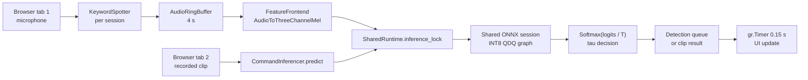

# CommandSense v3.2 - Model Card

<p align="center">
  
  
  
  
  
</p>

---

## Abstract

CommandSense v3.2 is an **application and integration release**, not a new model. It serves the unchanged v3.1 INT8 graph and the unchanged v3.0 float32 weights through a unified Gradio interface that exposes continuous microphone keyword spotting and single-clip analysis from one shared runtime. No training, fine-tuning, quantization-aware training, calibration fitting or graph rewrite is performed in this release. The model, its 37 classes, its operating point (`T = 1.311633`, `tau = 0.89`) and every inherited accuracy and quantization metric are identical to the v3.1 and v3.0 lineage.

The release contributes three things: a process-wide `SharedRuntime` that owns one ONNX Runtime session and one mel front-end, a thread-safe per-session `KeywordSpotter` with explicit lifecycle management, and a two-tab interface that isolates threshold tuning from the fitted operating point. On the reference six-core CPU host, one complete real-time window (feature extraction, INT8 inference, softmax and decision) has a median latency of **21.07 ms** and a mean of **21.40 ms**, which is **4.3%** of the 0.5 s hop. A concurrent stress test of 200 calls from eight threads produced no label or confidence mismatches and no exceptions.

This card documents the application layer. It deliberately makes **no accuracy claim**: all predictive metrics below are inherited and are reproduced only to establish that v3.2 serves the same decision function as its predecessors.

---

## 1. Release Identity

| Field | Value |
| :--- | :--- |
| Model name | CommandSense |
| Release | v3.2.0 |
| Release type | Application and integration release |
| Task | 37-class spoken command recognition with silence and OOV rejection |
| Classes | 35 command words, `_silence_`, `_unknown_` |
| Parameters | 1,217,349 |
| Input | `[batch, 3, 64, 63]` three-channel Log-Mel tensor from 1.0 s of 16 kHz mono audio |
| FP32 weights | `checkpoints/model_v3.2/CommandSense_v3.2.pth` (same weights as v3.0 and v3.1) |
| INT8 graph | `checkpoints/model_v3.2/CommandSense_v3.2_int8.onnx` (same QDQ graph as v3.1) |
| Calibration | `configs/calibration/CommandSense_calibration_v3.2.json` (`T = 1.311633`, `tau = 0.89`) |
| Runtime | ONNX Runtime 1.30.0 (CPU), PyTorch 2.14.0 fallback for the clip tab |
| Interface | Gradio 6.28.0, two tabs, one shared runtime per process |

The checkpoint directory is git-ignored, so both model files are release assets and must be placed in `checkpoints/model_v3.2/`. The calibration payload is versioned configuration and is tracked in git.

### 1.1 Artifacts

| Artifact | Role | Size |
| :--- | :--- | :--- |
| `CommandSense_v3.2.pth` | FP32 reference weights, loaded only when the PyTorch backend is selected | 4.675 MB (v3.0 checkpoint) |
| `CommandSense_v3.2_int8.onnx` | Deployed INT8 QDQ graph, preferred by the runtime | 1,260,833 bytes (1.202 MB) |
| `CommandSense_calibration_v3.2.json` | Versioned `T`, `tau`, rejection label and inherited calibration diagnostics | 1.1 KB |

The INT8 graph is 74.1% smaller than the 4.643 MB float32 ONNX reference. Artifact size is the only benefit claimed for quantization; Section 4.4 explains why no CPU latency gain is claimed.

---

## 2. Provenance: No New Model Was Trained

> **v3.2 uses the exact same weights and calibration as v3.1 (INT8) and v3.0 (FP32). No new training was performed. This release is purely an application and integration milestone.**

| Component | v3.0 | v3.1 | v3.2 |
| :--- | :--- | :--- | :--- |
| FP32 weights | Trained for 30 epochs | Same checkpoint | Same checkpoint |
| INT8 graph | Not present | Post-training static quantization (QDQ) | Same artifact |
| Temperature `T` | Fitted on validation | Reused after transfer check | Same value |
| Threshold `tau` | Fitted on validation | Reused after transfer check | Same value |
| Training or fine-tuning | Yes | None | None |
| Calibration re-fit | Yes | Transfer validated, not re-fitted | None |
| Primary contribution | Accuracy and memory optimization | INT8 deployment artifact | Unified real-time application layer |

The FP32 file distributed as `CommandSense_v3.2.pth` is the v3.0 checkpoint. The INT8 file distributed as `CommandSense_v3.2_int8.onnx` is the v3.1 QDQ artifact, whose source checkpoint was also v3.0. The v3.2 calibration JSON carries the same `T` and `tau` values as the v3.1 payload and records the v3.0 checkpoint as its source. Creating the v3.2 bundle therefore required copying artifacts and versioning configuration, not fitting or training anything.

Because the weights and calibration are unchanged, the decision function is unchanged. Any difference between a v3.1 and v3.2 prediction on the same input would indicate a serving defect, not a model improvement.

### 2.1 Inherited Predictive and Quantization Metrics

The following values come from the v3.0 evaluation and the v3.1 quantization report. They were not re-measured for v3.2.

| Metric | FP32 | INT8 | Notes |
| :--- | :-: | :-: | :--- |
| 35-command test accuracy | 95.8655% | 95.8655% | Inherited from v3.0; no new weights |
| Top-1 accuracy, full testing split | 96.1917% | 96.2247% | 12,105 clips, 37-class decisions |
| Top-1 agreement, INT8 vs FP32 | - | 99.55% | 54 flips in 12,105 clips |
| Mean absolute softmax deviation | - | 0.000201 | Decision-space fidelity |
| Coverage at `tau = 0.89` | 89.76% | 89.98% | Clips answered rather than rejected |
| Retained accuracy on answered clips | 99.50% | 99.50% | Precision at the operating point |
| False rejection rate | 7.15% | 6.96% | Command clips rejected |
| False acceptance rate | 11.71% | 12.04% | Rejection clips accepted |
| NLL, INT8 validation | 0.139424 at `T = 1` | 0.132338 at `T = 1.311633` | Calibration quality |
| ECE, INT8 validation | 0.009438 at `T = 1` | 0.005422 at `T = 1.311633` | Calibration quality |

The 35-command figure and the full-split figure are different quantities. The 35-command accuracy excludes the two rejection classes; the full-split figure includes 11,005 command clips and 1,100 synthetic rejection clips. The rejection clips are sampled from held-out recordings at load time, so full-split totals can move slightly between runs while the 35 command columns remain stable. This caveat is inherited from the v3.1 card.

Per-class INT8 agreement is 99.52% on the 35 commands (53 flips), 100.00% on `_silence_` (0 flips) and 99.82% on `_unknown_` (1 flip). Aggregate agreement is 99.55%.

---

## 3. Application Architecture



### 3.1 SharedRuntime

`SharedRuntime` is created once per `(model_version, device)` pair and cached in `_RUNTIMES`. It resolves the versioned artifacts through `CommandInferencer`, loads the label map and calibration JSON, materialises one ONNX Runtime session and constructs one `FeatureFrontend`. It then runs a zero-signal warm-up and records `warmup_ms`.

Both tabs and every browser session use that instance. There is no per-tab model load, no duplicate session and no second copy of the mel transform.

### 3.2 KeywordSpotter

`KeywordSpotter` owns one microphone session. It opens a 16 kHz mono `sounddevice` input stream and writes 100 ms blocks into a four-second ring buffer. A daemon thread classifies a 1.0 s window every 0.5 s and publishes accepted detections to a `queue.Queue`. The UI drains that queue without waiting on inference.

The class exposes `start`, `stop`, `close`, `poll`, `status` and context-manager methods. `start` is idempotent while the loop is alive; `stop` is safe to call repeatedly and from any thread; `status` returns an atomic snapshot for polling. The microphone is opened by `start`, so an idle interface holds no device.

### 3.3 Single-clip path

`CommandInferencer.predict` decodes the uploaded recording with the shared audio loader, applies the same `AudioToThreeChannelMel` transform, and runs either the ONNX session or the cached PyTorch model. The callback applies the slider `tau` to the returned probabilities locally. It does not call `set_calibration`, so the shared calibration remains unchanged.

### 3.4 Interface

`app.py` builds two Gradio tabs around the runtime. One `gr.Timer` per session polls detections every 0.15 s only while that session is listening. `Blocks.unload` stops the session's spotter when the tab closes or reloads, and an `atexit` handler stops any remaining spotters at process exit.

---

## 4. Real-time Performance

### 4.1 Measurement Environment

| Component | Value |
| :--- | :--- |
| CPU | Intel Core i5-9400, 6 physical cores, 6 logical processors, 2.90 GHz |
| Memory | 16 GB |
| Operating system | Windows 11 Pro, build 10.0.26200 |
| Python | 3.13.1 |
| PyTorch | 2.14.0+cpu |
| ONNX Runtime | 1.30.0, `CPUExecutionProvider`, default session options |
| NumPy | 2.5.3 |
| Gradio | 6.28.0 |
| Input | Deterministic synthetic 1.0 s waveform, 16 kHz, 16,000 samples |
| Measurement date | 2026-10-17 |

The synthetic input is used only to exercise the numerical path. Latency depends on tensor shapes, not on the semantic content of the audio, so a deterministic waveform makes the measurement repeatable without reading the dataset.

### 4.2 Per-window latency

Thirty untimed iterations warm the allocator and thread pools. The next 400 iterations time feature extraction, INT8 inference with softmax and argmax, and the combined path. Values are milliseconds per 1.0 s window.

| Stage | Mean | Median | p95 | Maximum |
| :--- | :-: | :-: | :-: | :-: |
| `FeatureFrontend` (waveform to `[1, 3, 64, 63]`) | 17.15 | 16.91 | 34.04 | 257.09 |
| ONNX inference, softmax and argmax | 4.25 | 3.58 | 8.16 | 39.52 |
| **Complete real-time window** | **21.40** | **21.07** | **38.84** | **260.97** |

The hop is 500 ms. The median window uses **4.21%** of the hop and the mean uses **4.28%** of it. The single 261 ms maximum is an operating-system scheduling outlier; the median and p95 describe normal operation.

Feature extraction dominates the path on this host. The INT8 graph itself accounts for roughly one fifth of the mean window time. This is consistent with the v3.1 finding that ONNX Runtime's CPU QDQ kernels are not faster than float32 for these small activations.

### 4.3 Cold start and warm-up

Five fresh `SharedRuntime` instances were constructed sequentially in one Python process. Each construction includes checkpoint resolution, label and calibration loading, ONNX session creation, front-end construction and the zero-signal warm-up.

| Metric | Median | Minimum | Maximum |
| :--- | :-: | :-: | :-: |
| Runtime construction | 230.97 ms | 189.81 ms | 495.39 ms |
| `warmup_ms` (first feature extraction + first inference) | 83.42 ms | 30.68 ms | 142.64 ms |

The first construction in a process is slower because it initialises native libraries and allocates thread pools; later constructions reuse those process-level resources. `warmup_ms` excludes Python imports and Gradio start-up. The application header reports the measured warm-up so an operator can see the actual first-inference cost of the running host.

Warm-up is performed before the microphone loop starts. Without it, the first real window would absorb one-time kernel selection and allocation costs, producing a visible latency spike in the first detection.

### 4.4 Relation to the v3.1 ONNX benchmark

The v3.1 quantization report measures the ONNX graph alone on precomputed features: 1.614 ms per clip for float32 and 2.718 ms per clip for INT8, median of five rounds of 200 calls. Those figures isolate `session.run` and exclude feature extraction, softmax, argmax and Python dispatch. The v3.2 numbers above measure the full serving path, so the two sets are complementary rather than directly interchangeable.

Both measurements agree on the deployment conclusion: INT8 reduces file size by 74.1%, but it does not improve CPU latency. The v3.2 application therefore makes no speed claim for quantization.

### 4.5 UI update cadence

A detection waits in the queue until the session's `gr.Timer` ticks. The timer interval is 150 ms, so the server-side delay between queue insertion and the next poll is at most one interval, plus inference and rendering. The browser round trip is not included in the measurements above. Polling is disabled while a session is idle, so an open but inactive tab does not impose recurring inference or queue work.

---

## 5. Thread Safety

### 5.1 Concurrency model

| Mechanism | Scope | Guarantee |
| :--- | :--- | :--- |
| `_RUNTIMES_LOCK` | Process | One runtime is constructed per version and device; concurrent callers receive the same instance |
| `SharedRuntime.inference_lock` | Process | All calls into the shared ONNX session are serialized |
| `_SESSIONS_LOCK` | Process | The session-to-spotter registry is mutated atomically |
| `KeywordSpotter._lock` (RLock) | One spotter | Start, stop and status transitions observe a consistent loop state |
| `queue.Queue` | One spotter | Accepted detections cross from the audio thread to the UI thread without loss |
| `AudioRingBuffer._lock` | One spotter | The PortAudio callback and the classifier never observe a torn window |

The ONNX Runtime session is shared by the live loop and the clip tab. Serializing `session.run` keeps the two paths from competing for the same execution resources and makes the contention bound explicit. The lock covers inference only; audio capture, feature extraction, UI polling and queue draining remain outside it.

Each browser session gets its own `KeywordSpotter`, so microphone selection, cooldown state, error state and detection history are isolated. The shared runtime supplies only immutable artifacts and the inference lock.

### 5.2 Stress validation

A deterministic feature tensor was classified once to establish a baseline. Eight threads then performed 25 locked predictions each, for 200 calls total.

| Observation | Result |
| :--- | :-: |
| Calls completed | 200 |
| Label mismatches against baseline | 0 |
| Confidence mismatches against baseline | 0 |
| Exceptions | 0 |
| Elapsed time | 1,294.4 ms |
| Serialized throughput | 155 calls/s |

The test establishes correctness under concurrent access, not parallel scalability. Because the inference lock serializes calls, throughput does not increase with thread count. The real-time path needs two windows per second, and the single-clip path is user initiated, so the measured serialized capacity is far above the application's demand.

### 5.3 Lifecycle guarantees

- `stop` signals the worker, joins it outside the state lock, then releases the stream. Repeated calls are harmless.
- If the worker does not join within the timeout, the stream is still released so a later `start` can reopen the device.
- A worker exception is captured in `status()["error"]`; the polling callback unregisters the spotter and returns the interface to idle.
- `Blocks.unload` handles tab close and refresh. `atexit` handles process shutdown.
- The registry stops a previous spotter when a session replaces it, so a reconnect cannot leak a microphone handle.

### 5.4 Boundaries

Thread safety applies within one Python process. The runtime is not a multi-process server, and it does not coordinate microphone ownership across processes or browser profiles. Two sessions that select the same exclusive device may still contend at the operating-system level; the second `start` reports a `SetupError` in that tab.

---

## 6. UI and UX Design

### 6.1 Tab structure

| Tab | Primary controls | Feedback | Intended task |
| :--- | :--- | :--- | :--- |
| **Real-time Keyword Spotting** | Input device, Start Listening, Stop Listening, Clear History | Colored status with text, latest-window confidence, rejection reason, cooldown, stream warnings, 100-entry history | Continuous microphone use and live acceptance testing |
| **Single Recording Analysis** | Record/upload, backend selector, `tau` slider, Classify Command | Verdict, top-6 probability chart, served and top-1 labels, threshold decision, `T`, backend | One-shot inspection and threshold exploration |

### 6.2 Design decisions

- **One runtime, two views.** The header states the model version, class count, warm-up, active backend and calibration source. This makes the loaded release visible before any inference is requested.
- **State is redundant by design.** The status dot is paired with text, so state does not depend on color perception alone.
- **Threshold tuning is isolated.** The clip tab's slider changes only the current request. A user can sweep `tau` to see rejection behaviour without silently changing the live operating point or another session's results.
- **Idle work is minimized.** The timer is inactive when not listening, and the microphone is not opened until the user starts the loop.
- **Failures are visible.** A missing model, graph or calibration payload produces a header warning and disabled controls instead of a blank page or a failed launch.
- **History is bounded.** The live history retains the most recent 100 detections. When the cap is reached, the list is refreshed with the newest entries rather than silently dropping them from the display.
- **Controls are large and labeled.** Primary actions use large buttons, device and backend choices are explicit, and every result field is named rather than encoded in an icon.

### 6.3 Interaction latency

The live view is refreshed every 150 ms while listening. A detection therefore appears within roughly one timer interval after it is queued, plus server inference and browser rendering. The clip tab runs synchronously: the button returns when decoding, feature extraction, inference and decision are complete, which is dominated by audio decoding rather than the 21 ms inference path.

### 6.4 Privacy

Live microphone audio stays in memory on the host that runs `app.py`: the ring buffer is overwritten continuously and detections are held in session state. Clips recorded or uploaded in the single-recording tab pass through Gradio's temporary upload cache; CommandSense itself does not archive them. `demo.launch()` binds locally by default; the interface is not hardened for public exposure and provides no authentication.

---

## 7. Limitations

### 7.1 Overlapping speech and the cocktail party problem

**The model does not separate overlapping talkers.** Each 1.0 s window is converted to a single three-channel spectrogram and mapped to one label by a softmax classifier. When two people speak at once, their energies add in the mel domain before inference. The network has no separation mask, speaker embedding, diarization stage or multi-label head.

Consequences:

- The louder talker tends to dominate the prediction, but the result is not guaranteed.
- Two talkers at similar levels can produce an unstable label or a confidence that does not reflect either utterance.
- The rejection classes may or may not fire. A confident wrong command is possible, so overlapping speech is not a safe operating condition.
- The 1.5 s cooldown can suppress a legitimate repeated command after an overlap-induced detection.

The training data contains single-speaker commands, background noise and single-speaker LibriSpeech utterances for `_unknown_`. It does not contain command-command mixtures. v3.2 adds no training data, so it cannot improve this behaviour.

**Planned for v4.0:** data mixing. The plan is to synthesize overlapping mixtures by adding interfering speech to command clips over a controlled SNR grid, including command-command pairs and speech-plus-noise cases, while preserving the rejection-class boundary. Evaluation would add an overlap-specific test split and report accuracy and coverage per SNR, rather than relying only on the clean single-speaker benchmark. This is a roadmap item, not a capability of v3.2.

### 7.2 Other limitations

- **No accuracy improvement.** v3.2 inherits v3.0 accuracy and v3.1 quantization fidelity. It should not be cited as a new accuracy result.
- **INT8 CPU latency.** The INT8 graph is 1.68x slower than float32 on the CPU provider in the v3.1 benchmark. The application benefit is artifact size, not CPU speed.
- **Fixed 1.0 s window.** Utterances longer than one second are truncated; shorter clips are zero-padded. A command that straddles a window boundary can be split across two inferences.
- **Fixed operating point.** `tau = 0.89` was fitted on the validation split of this dataset. Coverage may change under different microphones, room acoustics, languages or speaking rates.
- **Cooldown semantics.** Repeating the same command within 1.5 s is intentionally suppressed. This is a UX choice, not a model property.
- **Single-host latency evidence.** All timings come from one six-core CPU host with a synthetic input. Mobile, WebAssembly, GPU and browser measurements are not included.
- **No end-to-end browser benchmark.** The 21 ms figure covers server-side feature extraction and inference, not upload, WebM decoding, network transport or DOM rendering.
- **Microphone contention.** The application does not arbitrate device ownership across sessions or processes. Exclusive devices can fail to open.
- **Scope.** This is a 35-command keyword spotter with OOV rejection, not a general ASR system. It does not transcribe free speech.

---

## 8. Intended Use and Out of Scope

**Intended use:** local, interactive keyword spotting for a fixed 35-command vocabulary; demonstration and evaluation of the v3.0/v3.1 artifact lineage; single-clip threshold analysis; integration reference for embedding `KeywordSpotter` in another Python process.

**Out of scope:** safety-critical wake-word gating, multi-speaker transcription, overlapping-speech recognition, far-field command capture without validation, public multi-tenant deployment without authentication and rate limiting, and any use that requires a calibrated confidence guarantee outside the evaluated data distribution.

---

## 9. Reproducibility

### 9.1 Runtime

```bash
python app.py
```

The application resolves `MODEL_VERSION = "v3.2"` from `configs/config.py`, loads the INT8 graph from `checkpoints/model_v3.2/`, and reads `configs/calibration/CommandSense_calibration_v3.2.json`.

### 9.2 Smoke tests

```bash
python tests/test_v3_pipeline.py
python tests/test_calibration_smoke.py
```

These validate the feature shape, backend resolution and calibration math. The quantization test is only meaningful once the v3.1 artifacts exist:

```bash
python tests/test_v3_1_quantization.py
```

### 9.3 Latency protocol

The timings in Section 4 were collected with a standalone harness that imports `listen.get_shared_runtime`, feeds a deterministic 16,000-sample waveform through `FeatureFrontend`, and times `OnnxKeywordSpotter.predict` under `inference_lock`. Thirty untimed iterations precede 400 timed iterations. Cold start is the median of five fresh `SharedRuntime` constructions in one process.

The harness is intentionally not committed: it depends on host-specific thread pools and is not a pass/fail test. The measurement protocol, input shape, package versions and host are recorded here so the result can be reproduced or compared on another machine.

### 9.4 What is not reproduced

No training, evaluation, quantization or calibration fit is part of v3.2. Reproducing v3.0 metrics requires `train.py` and `evaluate.py`; reproducing the INT8 artifact requires `export_onnx.py` and `quantize_int8.py`. Those steps are documented in the root README and the respective model cards.

---

## 10. Files in This Folder

| File | Contents |
| :--- | :--- |
| `README.md` | This application-layer model card |

---

## Licence

Released under the MIT Licence. The datasets retain their own terms (CC BY 4.0). See the repository root `README.md` for dataset attribution and citation.
